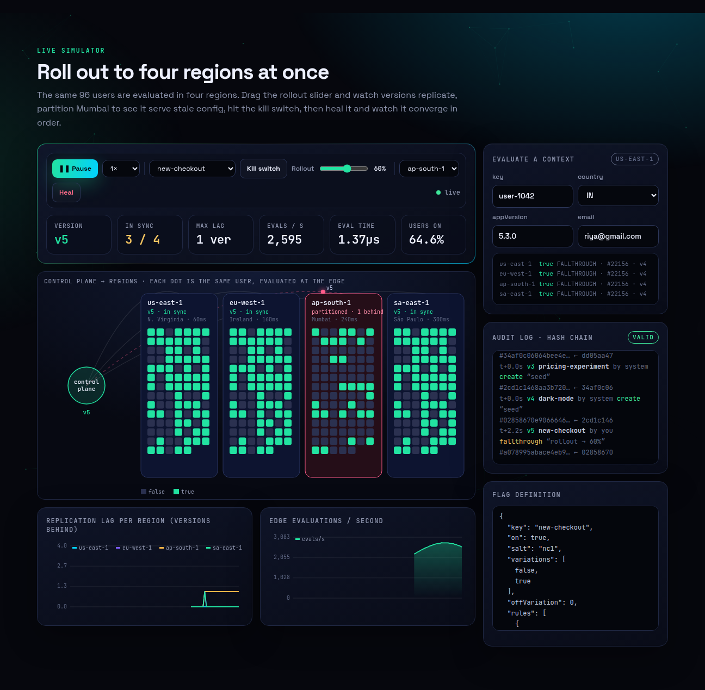
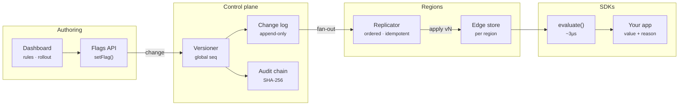
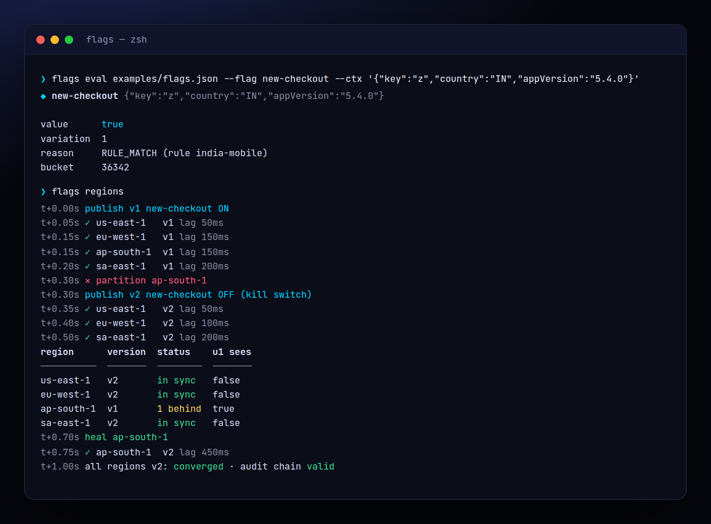
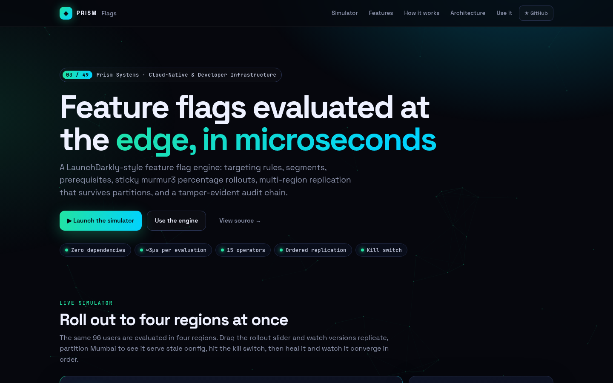
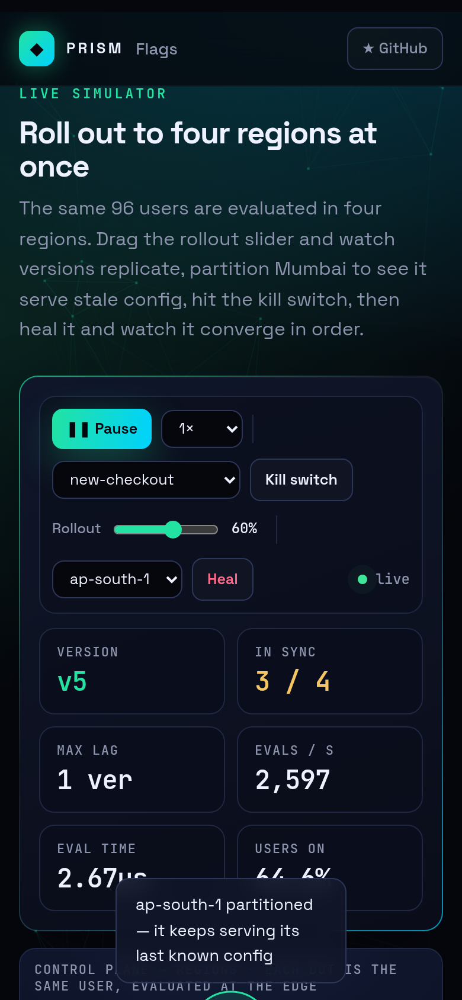

<!-- Prism Systems 03/49 -->
<p align="center">
  
</p>

<p align="center">
  
</p>

<p align="center">
  <a href="https://github.com/krishyaa06/prism-flags/actions/workflows/ci.yml"></a>
  <a href="https://krishyaa06.github.io/prism-flags/"></a>
  
  
  
  <a href="LICENSE"></a>
</p>

<p align="center">
  <a href="https://krishyaa06.github.io/prism-flags/"><b>Live simulator</b></a> ·
  <a href="docs/ARCHITECTURE.md"><b>Architecture</b></a> ·
  <a href="docs/USAGE.md"><b>Docs</b></a> ·
  <a href="#-quick-start"><b>Quick start</b></a>
</p>

<p align="center">
  <a href="https://krishyaa06.github.io/prism-flags/"></a>
</p>


## ⚡ Overview

Feature flags decouple deploy from release, but at scale they become a distributed system. Every region needs the same answer for the same user, changes must propagate in order, and a kill switch has to work even when one region is cut off. Prism Flags implements the evaluation semantics of commercial flag services and the replication model behind them in a few hundred lines you can read.

## ✨ Features

| | Feature | Details |
| :-: | --- | --- |
| ⚑ | **Targeting rules** | 15 operators (`in`, `endsWith`, `matches`, `semverGte`, `before`, `gt`…), negation, array attributes and per-user targets. |
| ◎ | **Segments** | Reusable audiences with include/exclude lists and their own rules, referenced via `segmentMatch`. |
| % | **Sticky rollouts** | `murmur3(flag.salt.key) % 100000` buckets users the same way in every region. Raising the percentage never flips users out. |
| ⛓ | **Prerequisites** | A flag can require another flag's variation, with cycle protection, which is how experiments depend on launches. |
| 🌍 | **Multi-region replication** | A versioned control plane pushes changes to regions. Delivery is idempotent, out-of-order changes are buffered and applied in sequence. |
| ✂ | **Partition tolerant** | A partitioned region keeps serving its last known config and catches up in order when it heals. |
| # | **Audit hash chain** | Every change records actor, comment and a field diff, chained with SHA-256 so tampering is detectable. |
| ⚡ | **Fast evaluation** | Pure functions with a regex cache: roughly 3µs per evaluation on Node 20, millions per second for simple flags. |

## 🏗️ Architecture



### How it works

1. **Define** — A flag has variations, targets, ordered rules, a fallthrough and an off variation. Rules contain clauses on context attributes.
2. **Evaluate** — Order: off → prerequisites → individual targets → first matching rule → fallthrough. Each result carries a reason such as `RULE_MATCH` or `PREREQUISITE_FAILED`.
3. **Bucket** — Rollouts hash flag key, salt and user key into 100,000 buckets and walk the cumulative weights. No state is stored per user.
4. **Publish** — The control plane assigns a global version, appends to the change log, writes an audit entry and fans the change out to every region.
5. **Converge** — Regions apply version N only after N−1. Gaps are buffered. After a partition, a region drains its buffer or `resync()`s from the log.

More detail in [docs/ARCHITECTURE.md](docs/ARCHITECTURE.md).

## 🚀 Quick Start

**Try it in the browser:** [https://krishyaa06.github.io/prism-flags/](https://krishyaa06.github.io/prism-flags/), no install needed.

```bash
# CLI, no install
npx github:krishyaa06/prism-flags --help

# add the engine to a project
npm install github:krishyaa06/prism-flags
```

### JavaScript API

```js
import { evaluate, percent, Region, ControlPlane } from "prism-flags";

const flag = {
  key: "new-checkout", on: true, variations: [false, true],
  rules: [{ id: "india-v5", clauses: [
    { attribute: "country", op: "in", values: ["IN"] },
    { attribute: "appVersion", op: "semverGte", values: ["5.2.0"] },
  ], variation: 1 }],
  fallthrough: percent(10),          // 10% of everyone else
};

evaluate(flag, { key: "u-1", country: "IN", appVersion: "5.3.0" });
// → { value: true, variation: 1, reason: { kind: "RULE_MATCH", ruleId: "india-v5" } }

// multi-region
const regions = ["us-east-1", "ap-south-1"].map((n) => new Region(n));
const cp = new ControlPlane(regions);
cp.setFlag(flag, { actor: "alice", comment: "launch" });
cp.tick(1);                          // deliver
regions[1].evaluate("new-checkout", { key: "u-1" });
console.log(cp.verifyAudit());       // true
```

| Export | What it does |
|---|---|
| `evaluate(flag, ctx, { flags, segments })` | `{ value, variation, reason, bucket? }` |
| `percent(p)` | Boolean rollout helper (`p`% get variation 1) |
| `bucket(flagKey, salt, key)` | Stable bucket in `[0, 100000)` |
| `segmentMatch(segment, ctx)` | Segment membership |
| `OPS` | Operator table (extendable) |
| `new ControlPlane(regions)` | `setFlag`, `publish`, `tick`, `resync`, `lag`, `verifyAudit`, `audit`, `log` |
| `new Region(name, { latency })` | `apply(change)`, `evaluate(key, ctx)`, `partitioned`, `version` |
| `diff(a, b)` | Field-level diff used by the audit log |

### CLI

```bash
$ npx github:krishyaa06/prism-flags eval examples/flags.json --flag new-checkout --ctx '{"key":"u1","country":"IN","appVersion":"5.4.0"}'
$ npx github:krishyaa06/prism-flags rollout examples/flags.json --flag pricing-experiment
$ npx github:krishyaa06/prism-flags bench examples/flags.json
$ npx github:krishyaa06/prism-flags regions
```

<p align="center"></p>

| Command | Description |
|---|---|
| `flags eval <file> --flag k --ctx '{…}'` | Evaluate one context and show the reason |
| `flags rollout <file> --flag k [--users N]` | Variation distribution over synthetic users |
| `flags bench <file> [--n N]` | Per-evaluation latency |
| `flags regions` | Replication, partition and kill-switch timeline |

## 📸 Screenshots

<table>
  <tr>
    <td width="68%"></td>
    <td width="32%"></td>
  </tr>
</table>

## 🧠 Design Decisions

- **Stateless stickiness.** Bucketing is a pure hash of flag key, salt and user key, so every region and SDK agrees without coordination. Changing the salt reshuffles an experiment.
- **Monotonic rollouts.** Users are "in" when their bucket is below the cumulative weight, so growing 20% → 60% only adds users.
- **Total order of changes.** The control plane is the single writer and assigns a global version. Regions apply strictly in order and buffer gaps, which gives causal consistency for dependent flags and segments.
- **Fail static.** A partitioned region keeps evaluating its last config instead of failing closed or open.
- **Explainability.** Every evaluation returns a reason (`TARGET_MATCH`, `RULE_MATCH` + rule id, `FALLTHROUGH`, `PREREQUISITE_FAILED`, `OFF`, `ERROR`) for debugging and experiment analysis.

## 🏭 Production Notes

To run this for real traffic:

- Back `ControlPlane.log` with a durable store (Postgres, DynamoDB) and stream changes to regions over SSE, WebSockets or a message bus (Kafka, NATS JetStream).
- Use the same `evaluate()` inside server SDKs and edge workers (Cloudflare Workers, Lambda@Edge). It has no Node dependencies.
- Send evaluation events (flag, variation, reason) to your analytics warehouse for experiment results.
- Protect the authoring API with RBAC and approvals, and anchor the audit chain head in a write-once store.

## 📁 Project Structure

```text
prism-flags/
├── assets/
│   └── logo.svg
├── bin/
│   └── flags.js
├── css/
│   └── app.css
├── docs/
│   ├── ARCHITECTURE.md
│   └── USAGE.md
├── examples/
│   └── flags.json
├── js/
│   └── app.js
├── src/
│   ├── lib/
│   │   ├── cli.js
│   │   ├── hash.js
│   │   ├── rng.js
│   │   └── sha256.js
│   ├── evaluate.js
│   ├── index.js
│   └── region.js
├── test/
│   └── flags.test.js
├── .gitignore
├── LICENSE
├── README.md
├── index.html
└── package.json
```

## 🧪 Tests

```bash
npm test
```

The test suite uses the built-in `node:test` runner, so there is nothing to install. CI runs it on Node 20 and 22.

## 🗺️ Roadmap

- [ ] SSE streaming server and browser SDK
- [ ] Experiment results with CUPED
- [ ] Scheduled flag changes
- [ ] Stale flag detection

## 🤝 Contributing

1. Fork the repo and create a branch: `git checkout -b feat/my-idea`
2. Make your change in `src/` and add a test in `test/`
3. Run `npm test`, then open a Pull Request

## 🔷 Part of Prism Systems

**Prism Flags** is system **03 of 49** in **Prism Systems**, a series of open-source reference implementations of large-scale infrastructure by [Prism Protocol](https://dc.gg/prismprotocol). Each one ships a real engine, a CLI and a live simulator, all with zero dependencies.

## 👤 Author

<table>
  <tr>
    <td align="center">
      <a href="https://github.com/krishyaa06"><br><b>Soumya Bhandare</b></a><br>
      <sub>Founder @ Prism Protocol</sub>
    </td>
    <td>
      <a href="https://dc.gg/prismprotocol"></a><br>
      <a href="https://instagram.com/prism_protocol_"></a><br>
      <a href="https://x.com/krishyaa06"></a>
    </td>
  </tr>
</table>

## 📄 License

Released under the [MIT License](LICENSE).

<p align="center">
  <b>If this helped you learn something, consider giving it a ⭐</b><br>
  <sub>"Build. Create. Compete." · Made with ⚡ by Prism Protocol</sub>
</p>


