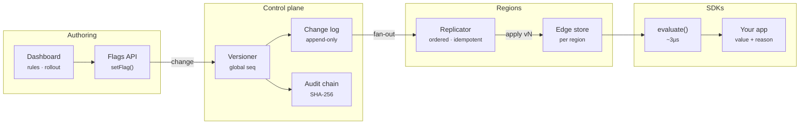

# Prism Flags — Architecture

Feature flags decouple deploy from release, but at scale they become a distributed system. Every region needs the same answer for the same user, changes must propagate in order, and a kill switch has to work even when one region is cut off. Prism Flags implements the evaluation semantics of commercial flag services and the replication model behind them in a few hundred lines you can read.

## System diagram

## How it works

1. **Define** — A flag has variations, targets, ordered rules, a fallthrough and an off variation. Rules contain clauses on context attributes.
2. **Evaluate** — Order: off → prerequisites → individual targets → first matching rule → fallthrough. Each result carries a reason such as `RULE_MATCH` or `PREREQUISITE_FAILED`.
3. **Bucket** — Rollouts hash flag key, salt and user key into 100,000 buckets and walk the cumulative weights. No state is stored per user.
4. **Publish** — The control plane assigns a global version, appends to the change log, writes an audit entry and fans the change out to every region.
5. **Converge** — Regions apply version N only after N−1. Gaps are buffered. After a partition, a region drains its buffer or `resync()`s from the log.

## Design decisions

- **Stateless stickiness.** Bucketing is a pure hash of flag key, salt and user key, so every region and SDK agrees without coordination. Changing the salt reshuffles an experiment.
- **Monotonic rollouts.** Users are "in" when their bucket is below the cumulative weight, so growing 20% → 60% only adds users.
- **Total order of changes.** The control plane is the single writer and assigns a global version. Regions apply strictly in order and buffer gaps, which gives causal consistency for dependent flags and segments.
- **Fail static.** A partitioned region keeps evaluating its last config instead of failing closed or open.
- **Explainability.** Every evaluation returns a reason (`TARGET_MATCH`, `RULE_MATCH` + rule id, `FALLTHROUGH`, `PREREQUISITE_FAILED`, `OFF`, `ERROR`) for debugging and experiment analysis.

## Production notes

To run this for real traffic:

- Back `ControlPlane.log` with a durable store (Postgres, DynamoDB) and stream changes to regions over SSE, WebSockets or a message bus (Kafka, NATS JetStream).
- Use the same `evaluate()` inside server SDKs and edge workers (Cloudflare Workers, Lambda@Edge). It has no Node dependencies.
- Send evaluation events (flag, variation, reason) to your analytics warehouse for experiment results.
- Protect the authoring API with RBAC and approvals, and anchor the audit chain head in a write-once store.
